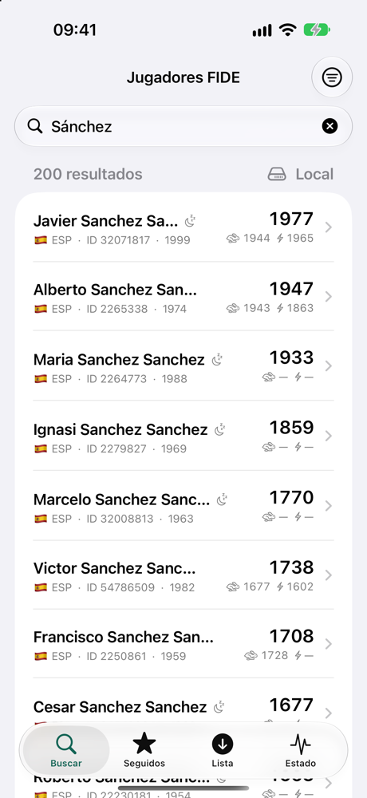
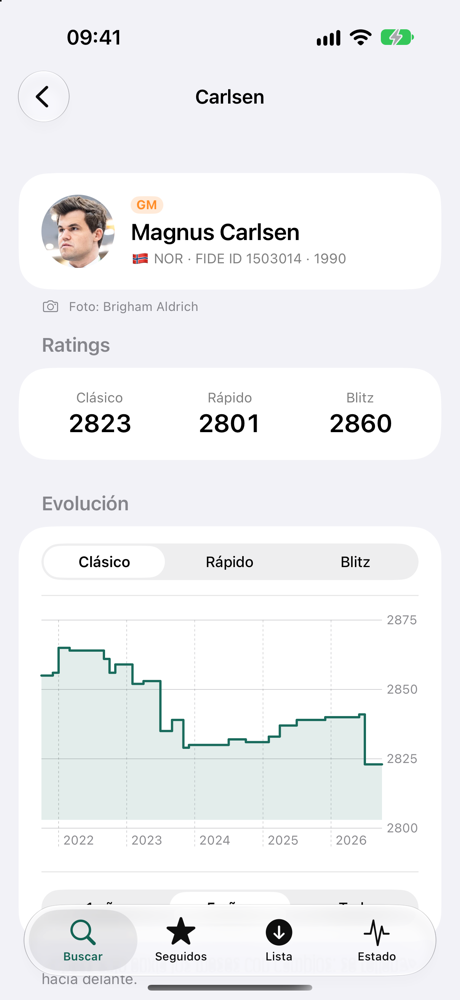
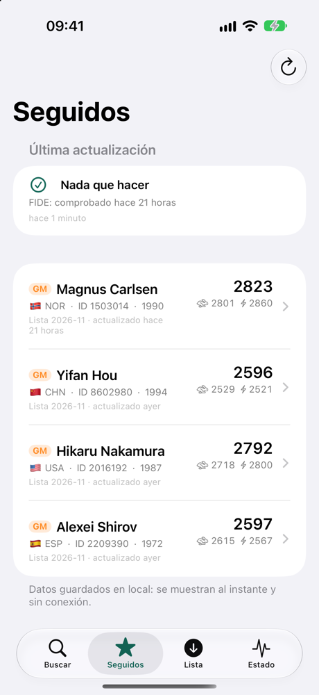
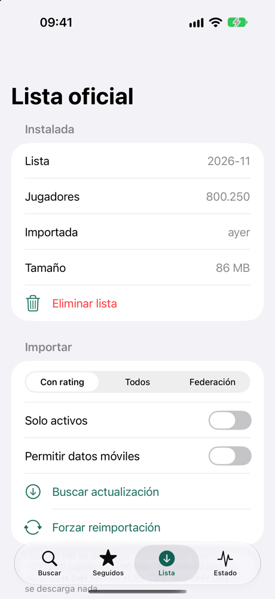
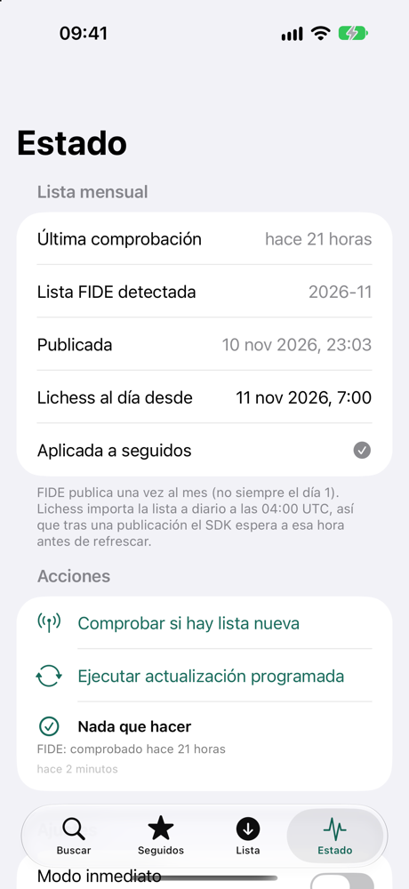
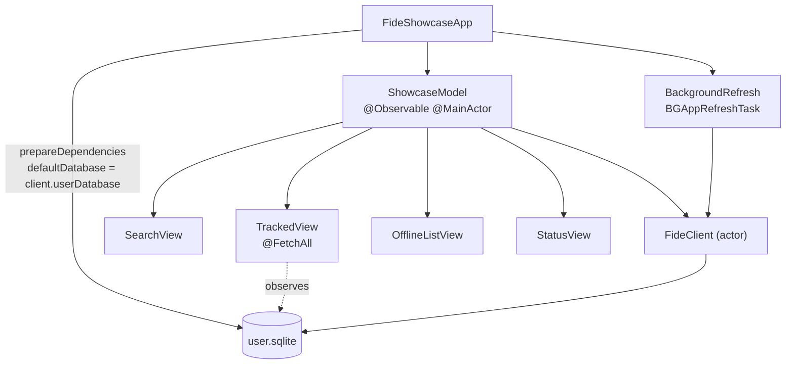
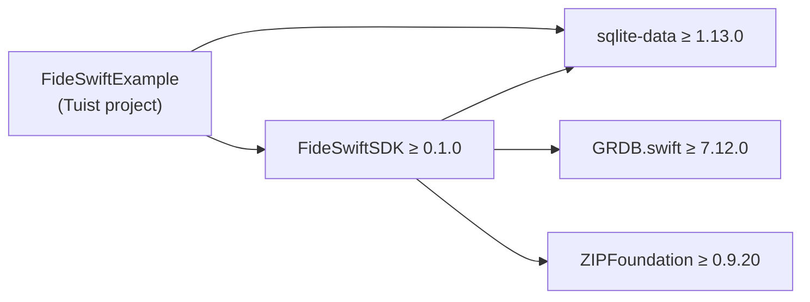

# FideSwiftExample

An iOS SwiftUI app that showcases **[FideSwiftSDK](https://github.com/NSStudent/FideSwiftSDK)**: searching FIDE chess players, tracking them, keeping their ratings up to date when FIDE publishes a new list, and working with the official list offline.

<p align="center">
  
  
  
  
  
</p>

> The app UI is in Spanish.

## What it shows

| Tab | Screen | SDK features |
|---|---|---|
| **Buscar** (Search) | Live search, player detail | `searchStream` (debounce + cancellation), `.auto` / Lichess / local sources, `LocalSearchFilter`, `player(id:)`, `ratingHistory(id:)` rendered with Swift Charts, photo credit, `track` / `untrack`, snapshots |
| **Seguidos** (Tracked) | Tracked players | `@FetchAll` observing `client.userDatabase`, pull to refresh with `performScheduledUpdate(force:)`, `UpdateReport` with rating deltas |
| **Lista** (List) | Offline official list | `syncFullList(filter:force:policy:)` with progress, Wi-Fi/cellular policy, `fullListInfo()`, `removeFullList()` |
| **Estado** (Status) | Update strategy | Detected FIDE release, when Lichess will be current (`UpdatePlanner.lichessReadyAt`), `checkForListUpdate`, live `events()`, immediate mode |

It also registers a `BGAppRefreshTask` that calls `performScheduledUpdate(UpdateOptions(allowListDownload: false))`, and runs an update every time the app becomes active.



## Requirements

| | Version |
|---|---|
| iOS | 18.0+ (iPhone and iPad) |
| Xcode | 16.0+ |
| [Tuist](https://tuist.dev) | 4.215.0 (pinned in `mise.toml`) |



## Running it

The Xcode project is generated with Tuist and is not committed.

```bash
git clone https://github.com/NSStudent/FideSwiftExample.git
cd FideSwiftExample
mise install          # installs the pinned Tuist version (or install Tuist any other way)
tuist install
tuist generate        # creates and opens FideShowcase.xcworkspace
```

Then run the **FideShowcase** scheme on a simulator or device. No API keys or accounts are needed: the SDK uses the public Lichess FIDE API and the public FIDE downloads.

To work on the SDK and the app at the same time, clone both repositories side by side and swap the package in `Project.swift` for a local one:

```swift
.package(path: "../FideSwiftSDK"),
```

## Project layout

```
Project.swift              Tuist manifest: app target, Info.plist, packages
Tuist.swift
mise.toml                  Pinned Tuist version
FideShowcase/
  Sources/
    FideShowcaseApp.swift  Entry point, database dependency, background refresh
    ShowcaseModel.swift    App state shared by the tabs (client, events, updates, list sync)
    RootView.swift         Tab bar
    SearchView.swift       Search as you type, source and filters
    PlayerDetailView.swift Photo + credit, ratings, history chart, tracking
    TrackedView.swift      Tracked players and update report
    OfflineListView.swift  Official list download/import
    StatusView.swift       Release status, actions and SDK events
    Components.swift       Rows, title badges, federation flags
  Resources/
    Assets.xcassets
```

## License

MIT. See [LICENSE](LICENSE). Player data comes from FIDE and Lichess. Player photos belong to their authors and the app always shows their credit.
